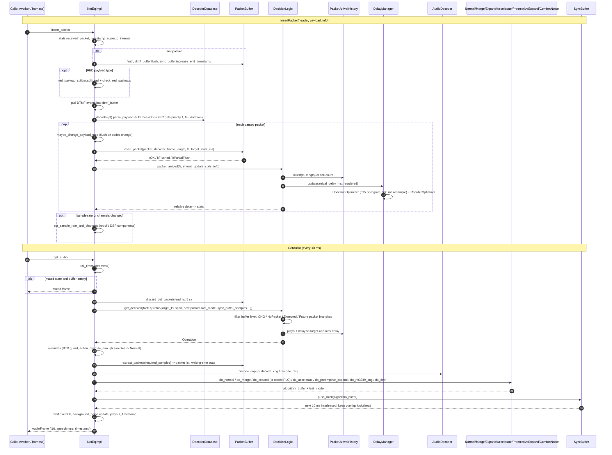
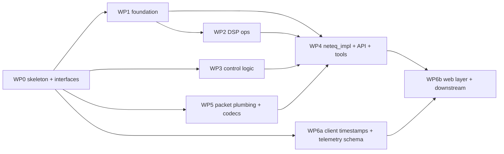

# NetEq WebRTC parity plan

Status: plan only, nothing ported yet. Branch `neteq-webrtc-parity`.
Reference: WebRTC at rev `6341cca49ffcad6fcb4603bd6cd1325fd0fe28bd`, sparse clone in
`~/Documents/webrtc-src` (`modules/audio_coding/neteq`, `api/neteq`, `api/audio_codecs`,
`common_audio/signal_processing`, `modules/audio_coding/codecs/{cng,pcm16b,opus}`).

## 1. The point

Our `neteq` crate today is "NetEq-inspired": float samples, its own decision tree, wall-clock
arrival times, no sync buffer, no merge, no fixed-point DSP. Almost nothing in it is
structurally WebRTC. So this is a rewrite, not a refactor. The target is a line-by-line port of
WebRTC NetEq that produces **bit-exact int16 output** versus the C++ NetEq for PCM16B input, under
a simulated clock, with the same decisions every 10 ms.

The example I'd use is a flight data recorder. Two planes (C++ NetEq and ours) fly the same
route with the same inputs. If both black boxes log the same altitude, heading and throttle at
every tick, the planes are the same plane. The harness under `neteq/parity` is the recorder;
section 7 lists exactly which channels it records.

What "bit-exact" requires, beyond porting the code:

- Same integer semantics. C code that relies on two's-complement wraparound (for example
  `corr += a*b >> s` in `WebRtcSpl_CrossCorrelationC`) must use `wrapping_*` in Rust, and
  every `static_cast<int>(double)` must be a truncating `as i32`.
- Same SPL variant. On arm64 WebRTC compiles NEON versions of some SPL kernels, and
  `CrossCorrelationNeon` accumulates in 64 bits and shifts once at the end, while the C version
  shifts every product. The results differ. **We port the generic C variants, and the C++
  harness must be built without NEON** (no `WEBRTC_HAS_NEON`, no `WEBRTC_ARCH_ARM_V7` asm).
  This machine is arm64, so this is not academic.
- Same time base. All delay estimation runs on `TickTimer` ticks (one per `GetAudio`), never
  on wall clock. Arrival "time" is the tick count at `InsertPacket`.
- Same call interleaving. Both sides must see the identical sequence of
  `InsertPacket` / `GetAudio` calls.

## 2. Module mapping

Legend for "distance": **rewrite** means the current code is not a starting point; **close**
means the current code has the right shape and needs an exact re-port; **new** means nothing
exists today.

### 2.1 Core NetEq (`modules/audio_coding/neteq`)

| WebRTC file | Target Rust module | Current Rust equivalent | Distance | SPL / common_audio deps |
|---|---|---|---|---|
| `neteq_impl.{h,cc}` | `neteq_impl.rs` | `neteq.rs` (float pipeline, leftover vectors, own decision tree, bypass mode) | rewrite | none directly |
| `decision_logic.{h,cc}` | `decision_logic.rs` | `neteq.rs::get_decision` (old BLF thresholds with 85 ms offset; WebRTC now uses `PacketArrivalHistory` playout delay) | rewrite | none |
| `delay_manager.{h,cc}` | `delay_manager.rs` | `delay_manager.rs` (wall-clock `Instant`, mixes in min/max, no reorder optimizer) | rewrite | none |
| `delay_constraints.{h,cc}` | `delay_constraints.rs` | min/max logic inside `delay_manager.rs` | rewrite | none |
| `underrun_optimizer.{h,cc}` | `underrun_optimizer.rs` | histogram use inside `delay_manager.rs` | rewrite | none |
| `reorder_optimizer.{h,cc}` | `reorder_optimizer.rs` | none | new | none |
| `histogram.{h,cc}` | `histogram.rs` | `histogram.rs` (f64 quantile argument) | close | none |
| `packet_arrival_history.{h,cc}` | `packet_arrival_history.rs` | `RelativeArrivalDelayTracker` in `delay_manager.rs` | rewrite | `RtpTimestampUnwrapper` (rtc_base) |
| `buffer_level_filter.{h,cc}` | `buffer_level_filter.rs` | `buffer_level_filter.rs` (carries sample rate, f64 helpers) | close | none |
| `packet.{h,cc}` | `packet.rs` | `packet.rs` (`AudioPacket` with `Instant`, ms durations) | rewrite | `IsNewerTimestamp` (modules/include) |
| `packet_buffer.{h,cc}` | `packet_buffer.rs` | `buffer.rs` (smart flush on by default with different constants) | rewrite | none |
| `decoder_database.{h,cc}` | `decoder_database.rs` | `HashMap<u8, Box<dyn AudioDecoder>>` in `neteq.rs` | new | none |
| `timestamp_scaler.{h,cc}` | `timestamp_scaler.rs` | none | new | none |
| `red_payload_splitter.{h,cc}` | `red_payload_splitter.rs` | none in crate (videocall-client unpacks its own non-RFC-2198 RED) | new | none |
| `dtmf_buffer.{h,cc}` | `dtmf_buffer.rs` | none | new | none |
| `dtmf_tone_generator.{h,cc}` | `dtmf_tone_generator.rs` | none | new | none |
| `statistics_calculator.{h,cc}` | `statistics_calculator.rs` | `statistics.rs` (wall-clock per-second rates, reorder telemetry) | rewrite; telemetry moves to wrapper | none |
| `expand_uma_logger.{h,cc}` | not ported | none | out of scope (UMA) | none |
| `audio_vector.{h,cc}` | `audio_vector.rs` | none | new | none |
| `audio_multi_vector.{h,cc}` | `audio_multi_vector.rs` | none | new | none |
| `sync_buffer.{h,cc}` | `sync_buffer.rs` | `leftover_samples: Vec<f32>` | new | none |
| `dsp_helper.{h,cc}` | `dsp_helper.rs` | `signal.rs::crossfade` (float) | new | `WebRtcSpl_DownsampleFast`, `WebRtcSpl_MaxIndexW16`, `SPL_ABS_W32` |
| `cross_correlation.{h,cc}` | `cross_correlation.rs` | `signal.rs::best_normalized_correlation` (float) | new | `WebRtcSpl_CrossCorrelation`, `WebRtcSpl_MaxAbsElementW16`, `WebRtcSpl_NormW32` |
| `random_vector.{h,cc}` | `random_vector.rs` | `simple_random()` (float) | new | none |
| `background_noise.{h,cc}` | `background_noise.rs` | none | new | `AffineTransformVector`, `DotProductWithScale`, `FilterARFastQ12`, `FilterMAFastQ12`, `LevinsonDurbin`, `NormW32`, `SqrtFloor`, `SPL_SHIFT_W32` |
| `expand.{h,cc}` | `expand.rs` | `expand.rs` (float noise fill) | rewrite | `AffineTransformVector`, `CrossCorrelation`, `DivW32W16`, `DotProductWithScale`, `DownsampleFast`, `FilterARFastQ12`, `FilterMAFastQ12`, `GetSizeInBits`, `LevinsonDurbin`, `MaxAbsValueW16/W32`, `MaxIndexW32`, `MemSetW16`, `NormW32`, `ScaleAndAddVectorsWithRound`, `SqrtFloor`, `VectorBitShiftW16`, `VectorBitShiftW32ToW16`, `SPL_ABS_W16`, `SPL_SHIFT_W32`, `SPL_WORD16_MAX` |
| `merge.{h,cc}` | `merge.rs` | none (`decode_merge` is a stub) | new | `DotProductWithScale`, `DownsampleFast`, `MaxAbsValueW16/W32`, `NormW32`, `SqrtFloor`, `VectorBitShiftW32ToW16`, `SPL_SHIFT_W32` |
| `normal.{h,cc}` | `normal.rs` | `decode_normal` (copies samples) | new | `DivW32W16`, `DotProductWithScale`, `MaxAbsValueW16`, `NormW32`, `SqrtFloor`, `SPL_SHIFT_W32` |
| `time_stretch.{h,cc}` | `time_stretch.rs` | `time_stretch.rs` (float energy search) | rewrite | `DivW32W16`, `DotProductWithScale`, `MaxAbsValueW16/W32`, `NormW32`, `SqrtFloor`, `VectorBitShiftW32ToW16`, `SPL_SHIFT_W32`, plus `DspHelper::DownsampleTo4kHz`, `CrossCorrelationWithAutoShift`, `PeakDetection` |
| `accelerate.{h,cc}` | `accelerate.rs` | `Accelerate` in `time_stretch.rs` | rewrite | via `TimeStretch` |
| `preemptive_expand.{h,cc}` | `preemptive_expand.rs` | `PreemptiveExpand` in `time_stretch.rs` | rewrite | via `TimeStretch` |
| `comfort_noise.{h,cc}` | `comfort_noise.rs` | `cng.rs` (float LPC) | rewrite | `DspHelper` mute/unmute factors; `ComfortNoiseDecoder` |
| `nack_tracker.{h,cc}` | not ported | none | **absent at this rev** (see section 9) | n/a |
| `mock/*.h` | test doubles in `#[cfg(test)]` | none | new | n/a |
| `tools/neteq_test.{h,cc}`, `neteq_input.h`, `audio_sink.h` | `tools/neteq_test.rs` (feature `tools`) | `examples/neteq_player.rs` (cpal playback) | new | none |

### 2.2 Public API (`api/neteq`, `api/audio_codecs`)

| WebRTC file | Target Rust module | Current Rust equivalent | Distance |
|---|---|---|---|
| `api/neteq/neteq.h` (`NetEq`, `Config`, `Operation`, `Mode`, `NetEqNetworkStatistics`, `NetEqLifetimeStatistics`, `NetEqOperationsAndState`) | `api/neteq.rs`, `api/stats.rs`, `api/config.rs` | `NetEqConfig`, `Operation` (has extra `ExpandStart/End`, `TimeStretchBuffer`), `NetEqStats` | rewrite |
| `api/neteq/neteq_controller.h` (`NetEqController`, `NetEqStatus`, `PacketArrivedInfo`, `PacketBufferInfo`) | `api/neteq_controller.rs` | none | new |
| `api/neteq/delay_manager_interface.h` | `api/delay_manager_interface.rs` | none | new |
| `api/neteq/tick_timer.{h,cc}` | `api/tick_timer.rs` | none (`Instant` / `web_time`) | new |
| `api/neteq/*factory*` | `NetEqBuilder` with optional `Box<dyn NetEqController>` | none | simplified (see 9) |
| `api/audio_codecs/audio_decoder.{h,cc}` | `api/audio_decoder.rs` | `codec.rs::AudioDecoder` (`decode -> Vec<f32>`) | rewrite |
| `api/audio_codecs/audio_format.h` (`SdpAudioFormat`) | `api/audio_format.rs` (slim) | none | new |
| `api/audio/audio_frame.h` (subset) | `api/audio_frame.rs` | `AudioFrame` (f32, `vad_activity`) | rewrite |
| `api/rtp_headers.h`, `api/rtp_packet_info.h` (subset) | `api/rtp.rs` | `RtpHeader` in `packet.rs` | rewrite |

### 2.3 Codecs

| WebRTC file | Target Rust module | Current Rust equivalent | Distance | SPL deps |
|---|---|---|---|---|
| `codecs/cng/webrtc_cng.{h,cc}` (`ComfortNoiseDecoder`, encoder for tests) | `codecs/cng.rs` | `cng.rs` (float) | rewrite | decoder: `FilterAR`, `RandN`, `ScaleVector`, `Sqrt`, `WebRtcCng_K2a16`, `WebRtcCng_kDbov`; encoder (tests only): `AutoCorrelation`, `LevinsonDurbin`, `Energy`, `GetHanningWindow`, `ElementwiseVectorMult`, `DivW32W16`, `SPL_MUL_16_16_RSFT` |
| `codecs/pcm16b/*` + `codecs/legacy_encoded_audio_frame.cc` | `codecs/pcm16b.rs` | none | new | none (big-endian i16) |
| `codecs/opus/audio_decoder_opus.cc`, `audio_coder_opus_common.h` (`OpusFrame`), helpers from `opus_interface.cc` (`PacketHasFec`, `DurationEst`, `FecDurationEst`, `PlcDuration`) | `codecs/opus.rs` on `ropus` | `codec/native_opus.rs` (ropus, float out) | rewrite | none |
| none (browser) | `codecs/web/{webcodecs,safari}.rs` | `codec/webcodecs_decoder.rs`, `codec/safari_decoder.rs`, `codec/browser_detect.rs` | keep, adapt (see 8.2) | none |

### 2.4 SPL port (`common_audio/signal_processing`, generic C only)

One Rust module `spl/` with one file per C file, function names in snake case
(`WebRtcSpl_DotProductWithScale` becomes `spl::dot_product_with_scale`).

| C source | Functions needed |
|---|---|
| `include/spl_inl.h` | `NormW32`, `NormW16`, `NormU32`, `GetSizeInBits`, `SatW32ToW16`, `AddSatW32`, `SubSatW32`, `CountLeadingZeros32/64` |
| `include/signal_processing_library.h` (macros) | `SPL_SHIFT_W32`, `SPL_ABS_W16`, `SPL_ABS_W32`, `SPL_MUL_16_16`, `SPL_MUL_16_16_RSFT`, `SPL_WORD16_MAX/MIN`, `SPL_WORD32_MAX` |
| `min_max_operations.c` | `MaxAbsValueW16C`, `MaxAbsValueW32C`, `MaxAbsElementW16`, `MaxIndexW16`, `MaxIndexW32` |
| `cross_correlation.c` | `CrossCorrelationC` |
| `downsample_fast.c` | `DownsampleFastC` |
| `dot_product_with_scale.cc` | `DotProductWithScale` |
| `vector_scaling_operations.c` | `VectorBitShiftW16`, `VectorBitShiftW32ToW16`, `ScaleVector`, `ScaleAndAddVectorsWithRound` (C variant), `AffineTransformVector` |
| `vector_operations.c` | `ElementwiseVectorMult` (CNG encoder, tests) |
| `copy_set_operations.c` | `MemSetW16` |
| `division_operations.c` | `DivW32W16` |
| `third_party/spl_sqrt_floor/spl_sqrt_floor.c` | `SqrtFloor` (C variant, not `_arm.S`) |
| `spl_sqrt.c` | `Sqrt` |
| `filter_ar_fast_q12.c` | `FilterARFastQ12` (C, not `_armv7.S`) |
| `filter_ma_fast_q12.c` | `FilterMAFastQ12` |
| `filter_ar.c` | `FilterAR` |
| `levinson_durbin.c` | `LevinsonDurbin` |
| `randomization_functions.c` | `RandN` (+ `kRandNTable`), `RandU`, `IncreaseSeed` |
| `auto_correlation.cc`, `energy.c`, `get_hanning_window.c` | CNG encoder only (test support) |

Plus from `rtc_base`: `SequenceNumberUnwrapper` / `RtpTimestampUnwrapper`
(`rtc_base/numerics/sequence_number_unwrapper.h`), `IsNewerTimestamp` /
`IsNewerSequenceNumber` (`modules/include/module_common_types_public.h`), `saturated_cast`,
`SafeClamp`. These are small; put them in `rtc_base.rs`.

## 3. Target architecture

### 3.1 Crate layout

```
neteq/src/
  lib.rs                 re-exports api::*, NetEq builder
  api/                   mirrors api/neteq + api/audio_codecs
    neteq.rs             NetEq trait-less facade, Config, Operation, Mode, DecoderFormat
    stats.rs             NetEqNetworkStatistics, NetEqLifetimeStatistics, NetEqOperationsAndState
    neteq_controller.rs  NetEqController trait + NetEqStatus etc.
    delay_manager_interface.rs
    tick_timer.rs        TickTimer, Stopwatch, Countdown
    clock.rs             Clock trait, SystemClock, SimulatedClock
    audio_decoder.rs     AudioDecoder, EncodedAudioFrame, ParseResult, SpeechType
    audio_format.rs      SdpAudioFormat (slim)
    audio_frame.rs       AudioFrame (i16 interleaved), OutputSpeechType
    rtp.rs               RtpHeader, RtpPacketInfo
  rtc_base.rs            unwrappers, IsNewerTimestamp, saturated_cast
  spl/                   generic-C SPL port (section 2.4)
  neteq/                 one file per WebRTC file in section 2.1
  codecs/                cng.rs, pcm16b.rs, opus.rs, web/
  tools/                 neteq_test.rs, neteq_input.rs, audio_sink.rs (feature "tools")
  parity.rs              observer hooks (feature "parity", section 7)
  telemetry.rs           dashboard-facing NetEqStats JSON (section 8.3)
  web.rs, bin/           kept (section 8)
```

The internal `neteq/` directory keeps WebRTC's file names so a reviewer can diff a Rust file
against its C++ twin side by side. Each ported file carries a header comment naming the
WebRTC file and rev it came from.

### 3.2 Ownership: same boundaries, explicit borrows

WebRTC shares components through raw pointers: `Expand` holds `BackgroundNoise*`,
`SyncBuffer*`, `RandomVector*`, `StatisticsCalculator*`; `Merge` holds `Expand*` and
`SyncBuffer*`; `Normal` holds `DecoderDatabase*`; `PacketBuffer` holds `StatisticsCalculator*`.
In Rust, `NetEqImpl` owns every component as a plain field and passes the collaborators into
each call as `&mut` / `&` arguments. The component boundaries and call order stay identical;
only the plumbing changes. For example:

```rust
impl Expand {
    pub fn process(&mut self, ctx: &mut ExpandContext<'_>, output: &mut AudioMultiVector) -> i32;
}
pub struct ExpandContext<'a> {
    pub sync_buffer: &'a SyncBuffer,
    pub background_noise: &'a mut BackgroundNoise,
    pub random_vector: &'a mut RandomVector,
    pub statistics: &'a mut StatisticsCalculator,
}
```

`Merge::process(&mut self, input, &mut Expand, &mut ExpandContext, output)` follows the same
pattern. `NetEqImpl::set_sample_rate_and_channels` rebuilds the per-rate components exactly as
`SetSampleRateAndChannels` does (`AudioMultiVector`, `SyncBuffer`, `BackgroundNoise`,
`Expand`, `Merge`, `Normal`, `Accelerate`, `PreemptiveExpand`, `ComfortNoise`, and the
`RandomVector::reset()`).

The exception is `TickTimer`, which is read by `PacketBuffer` (packet waiting time),
`PacketArrivalHistory`, `UnderrunOptimizer`, `DecisionLogic` (countdown) and `NetEqImpl`.
It is a cloneable handle so components can keep it the way C++ does:

```rust
#[derive(Clone)]
pub struct TickTimer(Arc<TickTimerInner>); // ticks: AtomicU64 (Relaxed), ms_per_tick: i32
pub struct Stopwatch { timer: TickTimer, start_tick: u64 }   // elapsed_ticks(), elapsed_ms()
pub struct Countdown { stopwatch: Stopwatch, ticks_to_count: u64 } // finished()
```

`Arc<AtomicU64>` keeps `NetEq: Send` for native use while costing nothing measurable on wasm.

### 3.3 Fixed point everywhere

- All audio inside NetEq is `i16`, all state is the C type (`i16`, `i32`, `i64`, `usize`,
  `u32` for RTP timestamps). No `f32` inside the core.
- Float appears only where C++ uses `double`: `Histogram` start forget weight,
  `DelayManager::Config` (quantile, forget factors), mean waiting time. Conversions mirror the C++
  expression order exactly, for example `((1 << 30) as f64 * 0.95) as i32`.
- Arithmetic that can overflow in C uses `wrapping_*`; saturating casts use a ported
  `saturated_cast`.
- `size_t` underflow tricks (e.g. `sync_buffer->next_index() - overlap`) are ported with the
  same `usize` arithmetic and a debug assert, never "fixed".

### 3.4 Decoder interface

`EncodedAudioFrame` in C++ keeps a raw `AudioDecoder*`. In Rust the frame stays decoder-free
and the decoder is passed in at decode time; `NetEqImpl::decode_loop` already looks up the
decoder by payload type, so this costs nothing.

```rust
pub enum SpeechType { Speech = 1, ComfortNoise = 2 }

pub trait EncodedAudioFrame: Send {
    fn duration(&self) -> usize;            // samples per channel; cached at parse time
    fn is_dtx_packet(&self) -> bool { false }
    fn decode(&self, decoder: &mut dyn AudioDecoder, out: &mut [i16]) -> Option<DecodeResult>;
}

pub trait AudioDecoder: Send {
    fn parse_payload(&mut self, payload: Vec<u8>, timestamp: u32) -> Vec<ParseResult>; // default: one frame, priority 0
    fn decode(&mut self, encoded: &[u8], sample_rate_hz: i32, out: &mut [i16], speech: &mut SpeechType) -> i32;
    fn decode_redundant(&mut self, encoded: &[u8], sample_rate_hz: i32, out: &mut [i16], speech: &mut SpeechType) -> i32;
    fn has_decode_plc(&self) -> bool { false }
    fn decode_plc(&mut self, num_frames: usize, out: &mut [i16]) -> usize { 0 }
    fn generate_plc(&mut self, requested_samples_per_channel: usize, out: &mut Vec<i16>) {}
    fn reset(&mut self);
    fn error_code(&mut self) -> i32 { 0 }
    fn packet_duration(&self, encoded: &[u8]) -> i32 { K_NOT_IMPLEMENTED }
    fn packet_duration_redundant(&self, encoded: &[u8]) -> i32 { K_NOT_IMPLEMENTED }
    fn packet_has_fec(&self, encoded: &[u8]) -> bool { false }
    fn sample_rate_hz(&self) -> i32;
    fn channels(&self) -> usize;
}
```

Caching `duration()` at parse time is safe because PCM16B and Opus durations are pure
functions of a non-empty payload, and NetEq rejects empty payloads before parsing.

Decoders are created through a slim factory so `DecoderDatabase` keeps its WebRTC shape
(lazy creation, `SetCodecs`, `RegisterPayloadType`, CNG / DTMF / RED subtypes from the SDP name):

```rust
pub trait AudioDecoderFactory: Send {
    fn make_decoder(&self, format: &SdpAudioFormat) -> Option<Box<dyn AudioDecoder>>;
}
```

Built-in decoders: PCM16B (`L16`), Opus (`ropus`, native and wasm), CNG (`CN`, handled inside
`DecoderDatabase` as in C++). The web build adds the WebCodecs / JS backends (section 8.2).

### 3.5 Clocks

- `TickTimer` (above): the only time base for jitter estimation and decisions.
- `Clock` trait: `fn current_time_us(&self) -> i64`. Used once, in `ExtractPackets`, for
  `total_processing_delay_us = clock.now - packet_info.receive_time`. Production uses a
  `web_time`-backed `SystemClock`; tests and the harness inject `SimulatedClock`.
- `RtpPacketInfo.receive_time` is `Option<i64>` microseconds (`None` maps to
  `Timestamp::MinusInfinity()`).

### 3.6 Public API (Rust)

Same methods as `api/neteq/neteq.h`, snake case, with C++ return codes mapped to
`Result<_, NetEqError>` only at the facade. Internals keep the integer `Error` enum of
`NetEqImpl` so control flow is identical.

```rust
pub struct NetEq { inner: NetEqImpl }
impl NetEq {
    pub fn new(config: Config, deps: Dependencies) -> Self;
    pub fn insert_packet(&mut self, header: &RtpHeader, payload: &[u8], info: RtpPacketInfo) -> Result<()>;
    pub fn get_audio(&mut self, frame: &mut AudioFrame, action_override: Option<Operation>) -> Result<GetAudioResult>; // muted, sample rate
    pub fn set_codecs / register_payload_type / remove_payload_type / remove_all_payload_types;
    pub fn set_minimum_delay / set_maximum_delay / set_base_minimum_delay_ms / get_base_minimum_delay_ms;
    pub fn target_delay_ms / filtered_current_delay_ms / sync_buffer_size_ms;
    pub fn network_statistics(&mut self) -> NetEqNetworkStatistics;   // resets, like C++
    pub fn current_network_statistics(&self) -> NetEqNetworkStatistics;
    pub fn lifetime_statistics / operations_and_state / playout_timestamp / current_decoder_format;
    pub fn flush_buffers / set_maximum_buffer_packets / set_fast_accelerate;
}
```

`Config` mirrors `NetEq::Config` (defaults: `sample_rate_hz 48000`, `max_packets_in_buffer 200`,
`max_delay_ms 0`, `min_delay_ms 0`, `enable_fast_accelerate false`, `enable_muted_state false`,
`enable_rtx_handling false`, `for_test_no_time_stretching false`) plus two typed blocks that
replace field trials (section 9): `delay_manager: DelayManagerConfig` and
`smart_flushing: Option<SmartFlushingConfig>`.

## 4. GetAudio / InsertPacket flow



## 5. Work packages

### 5.0 Order and parallelism



- **WP0** is short and serial. One agent lands the crate skeleton with every public type and
  function signature from section 3 and the per-file module stubs (`todo!()` bodies), plus
  `TickTimer`, `rtc_base.rs` and `StatisticsCalculator` (fully ported, it is 250 lines with no
  dependencies and every other package calls it). Once WP0 merges, signatures are frozen;
  changing one needs a note to the other packages.
- **WP1, WP3, WP5, WP6a** run in parallel after WP0.
- **WP2** starts when WP1 has landed `spl/`, `audio_vector`, `audio_multi_vector`,
  `sync_buffer` and `dsp_helper`. WP1 delivers those first, in that order.
- **WP4** integrates everything. It can start the facade, the stats wiring and the tools
  against WP0 stubs, but its tests only pass once WP1 to WP5 are in.
- **WP6b** needs the WP4 API.

The old modules (`neteq.rs`, `buffer.rs`, `signal.rs`, float `expand.rs`, `time_stretch.rs`,
`cng.rs`, `statistics.rs`) are deleted in WP4 when the new pipeline is wired up, not before, so
the worker keeps building on the branch until WP6b switches it over.

Every package: `cargo fmt`, `cargo clippy -p neteq --all-targets -- -D warnings`,
`cargo test -p neteq`, and `cargo check --target wasm32-unknown-unknown -p neteq --no-default-features --features web`
must pass. Ported unit tests keep the C++ test names in snake case so coverage is traceable.

### 5.1 WP0: skeleton and interface freeze

- Files: `lib.rs`, `api/*`, `rtc_base.rs`, `neteq/statistics_calculator.rs`, stub files for every
  module in section 2, `Cargo.toml` (version `1.0.0-alpha`, features `native`, `web`, `tools`,
  `parity`), `LICENSE-WEBRTC` (BSD-3 text plus WebRTC `PATENTS`; we are copying BSD-licensed
  code into an MIT/Apache crate, so the notice must ship).
- Interfaces exported: everything in section 3.4 to 3.6, `NetEqController` trait,
  `DelayManagerInterface`, `StatisticsCalculator` methods (exact C++ method set).
- Tests to port: `api/neteq/tick_timer_unittest.cc`, `statistics_calculator_unittest.cc`.

### 5.2 WP1: foundation (SPL, vectors, helpers)

- Files: `spl/*` (section 2.4), `neteq/audio_vector.rs`, `neteq/audio_multi_vector.rs`,
  `neteq/sync_buffer.rs`, `neteq/dsp_helper.rs`, `neteq/cross_correlation.rs`,
  `neteq/random_vector.rs`.
- Interfaces: `AudioVector` is a circular buffer with the exact C++ growth policy
  (`Reserve` doubling, `begin_index_`/`end_index_`), because `CrossFade`, `PushFront` and
  `InsertAt` semantics depend on it. `SyncBuffer` derefs to `AudioMultiVector`.
- Tests to port: `audio_vector_unittest.cc`, `audio_multi_vector_unittest.cc`,
  `sync_buffer_unittest.cc`, `dsp_helper_unittest.cc`, `random_vector_unittest.cc`, and the
  relevant cases from `common_audio/signal_processing/signal_processing_unittest.cc`
  (macros, inline, min/max, vector scaling, division, sqrt, filters, randomization, cross
  correlation, downsample).
- Extra: property tests (`proptest`) for every SPL function against the C++ harness's
  per-function C ABI if the harness exposes it (section 7.4).

### 5.3 WP2: DSP operations

- Files: `neteq/background_noise.rs`, `neteq/expand.rs`, `neteq/merge.rs`, `neteq/normal.rs`,
  `neteq/time_stretch.rs`, `neteq/accelerate.rs`, `neteq/preemptive_expand.rs`,
  `neteq/comfort_noise.rs`, `codecs/cng.rs` (decoder, plus encoder for tests).
- Interfaces consumed: WP1 (`spl`, vectors, `DspHelper`, `RandomVector`),
  WP0 (`StatisticsCalculator`, `DecoderDatabase` stub for `active_cng_decoder()`).
- Interfaces exported: `Expand::{process, reset, set_parameters_for_normal_after_expand,
  set_parameters_for_merge_after_expand, mute_factor, muted, overlap_length, max_lag}`,
  `Merge::{process, required_future_samples}`, `Normal::process`,
  `Accelerate::process`, `PreemptiveExpand::process`, `ComfortNoise::{update_parameters,
  generate, reset}`, `BackgroundNoise::update`. Factories are dropped; `NetEqImpl`
  constructs directly (tests use the `Dependencies` struct instead, section 9).
- Tests to port: `background_noise_unittest.cc`, `expand_unittest.cc`, `merge_unittest.cc`,
  `normal_unittest.cc`, `time_stretch_unittest.cc`, `comfort_noise_unittest.cc`,
  `codecs/cng/cng_unittest.cc`. `time_stretch_unittest.cc` and `expand_unittest.cc` read
  `resources/audio_coding/testfile32kHz.pcm`, which the sparse clone lacks; WP2 either fetches
  the resource into `neteq/tests/resources/` (it is BSD) or replaces it with a fixed synthetic
  signal whose C++ output the harness records.

### 5.4 WP3: control logic

- Files: `neteq/histogram.rs`, `neteq/underrun_optimizer.rs`, `neteq/reorder_optimizer.rs`,
  `neteq/delay_manager.rs`, `neteq/delay_constraints.rs`, `neteq/packet_arrival_history.rs`,
  `neteq/buffer_level_filter.rs`, `neteq/decision_logic.rs`, `neteq/packet.rs`,
  `neteq/packet_buffer.rs`.
- Interfaces consumed: WP0 (`TickTimer`, `StatisticsCalculator`, `NetEqController`,
  `DecoderDatabase::is_comfort_noise` via a small trait so WP3 does not wait on WP5).
- Interfaces exported: `DecisionLogic: NetEqController`, `PacketBuffer` (full C++ method set,
  `is_obsolete_timestamp` static), `Packet` with C++ ordering (`Ord` that matches
  `operator<` including wraparound and priority).
- Notes: `PacketArrivalHistory` uses a `BTreeMap<i64, PacketArrival>` plus two `VecDeque`
  monotonic queues, matching `std::map` + `std::deque`. `PacketList` is a `VecDeque<Packet>`
  with the same insert-from-back search.
- Tests to port: `histogram_unittest.cc`, `underrun_optimizer_unittest.cc`,
  `reorder_optimizer_unittest.cc`, `delay_manager_unittest.cc`, `delay_constraints_unittest.cc`,
  `packet_arrival_history_unittest.cc`, `buffer_level_filter_unittest.cc`,
  `decision_logic_unittest.cc` (uses mock delay manager and BLF; hand-written fakes),
  `packet_buffer_unittest.cc`.

### 5.5 WP5: packet plumbing, DTMF, codecs

- Files: `neteq/decoder_database.rs`, `neteq/timestamp_scaler.rs`,
  `neteq/red_payload_splitter.rs`, `neteq/dtmf_buffer.rs`, `neteq/dtmf_tone_generator.rs`,
  `codecs/pcm16b.rs` (with `LegacyEncodedAudioFrame::split_by_samples`), `codecs/opus.rs`.
- Opus specifics (from `audio_decoder_opus.cc`, `audio_coder_opus_common.h`,
  `opus_interface.cc`): `parse_payload` emits an FEC frame (priority 1, timestamp minus
  redundant duration) when `PacketHasFec`, then the primary; `is_dtx_packet` is
  `payload.len() <= 2`; `generate_plc` is a no-op unless `generate_plc` is enabled (field trial
  default off); decode through `ropus::Decoder::decode` (i16) and `DecodeMode::Fec` for
  redundant frames.
- NACK: not in this package (section 9).
- Tests to port: `decoder_database_unittest.cc`, `timestamp_scaler_unittest.cc`,
  `red_payload_splitter_unittest.cc`, `dtmf_buffer_unittest.cc`,
  `dtmf_tone_generator_unittest.cc`, the PCM16B and Opus cases of `audio_decoder_unittest.cc`.

### 5.6 WP4: NetEqImpl, public API, tools, parity hooks

- Files: `neteq/neteq_impl.rs`, `api/neteq.rs` facade, `tools/{neteq_test,neteq_input,audio_sink}.rs`,
  `parity.rs`; delete the old float modules; update `examples/basic_usage.rs` and
  `examples/neteq_player.rs` to the new API.
- Interfaces consumed: everything.
- Interfaces exported: section 3.6 and section 7.
- `tools::NetEqTest` reproduces `NetEqTest::RunToNextGetAudio`: advance a `SimulatedClock` to
  the next event, insert every packet whose arrival time has come (with `receive_time = now`),
  then `GetAudio` on a 10 ms grid. This is the same driver the harness uses, so we have one
  definition of "the same inputs".
- Tests to port: `neteq_impl_unittest.cc` (heavy mock use: hand-written fakes or `mockall` as
  a dev-dependency), `neteq_network_stats_unittest.cc`, `neteq_stereo_unittest.cc`,
  `neteq_decoder_plc_unittest.cc`, and from `neteq_unittest.cc` everything that does not need
  RTP resource files (`LongCng*`, `UnknownPayloadType`, `DecoderError`,
  `GetAudioBeforeInsertPacket`, `SequenceNumberWrap*`, `TimestampWrap`, `DiscardDuplicateCng`,
  `CngFirst`, `MutedState*`, `TestConcealmentEvents`, `TestJitterBufferDelay*`,
  `NetEqNoTimeStretchingMode`). The `*BitExactness` checksum tests need WebRTC's RTP resources;
  the harness diff replaces them.

### 5.7 WP6: web layer and downstream consumers

Split in two so the client-side prep does not wait on WP4.

**WP6a (after WP0):**
- videocall-client: generate RTP-unit timestamps for NetEq (section 8.1). Unit tests for
  the mapping, including sequence wrap and RED recovery.
- `telemetry.rs`: define the dashboard-facing `NetEqStats` JSON (section 8.3) so dioxus-ui and
  `health_reporter` can be adjusted in parallel.

**WP6b (after WP4):**
- `web.rs` / `bin/neteq_worker.rs`: rebuild `WebNetEq` on the new API; `i16 -> f32`
  conversion at the boundary (`sample as f32 / 32768.0`); keep the worker message protocol
  (`Init`, `Insert`, `Flush`, `Clear`, `Close`, `Mute`, `SetDiagnostics`) unchanged.
- Decoder backends on web (section 8.2).
- dioxus-ui `neteq_chart.rs` and diagnostics, videocall-client `health_reporter.rs`,
  `dashboard.html`, `bin/dashboard_server.rs`: consume `telemetry::NetEqStats`.
- Bump `neteq` to `1.0.0` in `neteq/Cargo.toml`, `videocall-client/Cargo.toml`,
  `dioxus-ui/Cargo.toml`; CHANGELOG; README.
- Per CLAUDE.md this package goes through the roster: `frontend-rust-webtransport-and-websocket`
  for dioxus-ui / videocall-client, `e2e-test-sync` for E2E coverage of audio playback,
  `performance-reviewer` for worker CPU (fixed-point NetEq at 48 kHz per peer).

## 6. What we keep

- `web.rs` and `bin/neteq_worker.rs`: the worker shell, message protocol, mute handling,
  diagnostics toggle and Matomo log bridge stay. Only the NetEq calls inside change.
- Codec wrappers: `codec/webcodecs_decoder.rs`, `codec/safari_decoder.rs`,
  `codec/browser_detect.rs`, `scripts/opus-decoder.min.js`, `codec/native_opus.rs` (as the seed
  of `codecs/opus.rs`). They move under `codecs/` and implement the new `AudioDecoder` trait.
- Dashboard: `dashboard.html`, `DASHBOARD_README.md`, `bin/dashboard_server.rs`,
  `neteq_stats.jsonl` sample. They read `telemetry::NetEqStats`.
- Examples: `basic_usage.rs`, `neteq_player.rs` (rewritten against the new API),
  `examples/worker-example` (JS side unchanged).
- `error.rs` (`NetEqError`), extended with the `NetEqImpl::Error` codes.

Dropped: `bypass_mode`, `additional_delay_ms` (see 8.4), `Operation::{ExpandStart, ExpandEnd,
TimeStretchBuffer, ComfortNoise}`, `AudioFrame::vad_activity`, `SpeechType::Music`,
`signal.rs`, `q14` helpers move into `telemetry.rs`.

### 6.1 Downstream usage today

| Consumer | What it uses | Impact |
|---|---|---|
| `videocall-client/src/decode/neteq_audio_decoder.rs` | Talks to the worker only (`WorkerMsg::Insert { seq, timestamp, payload }` etc.), own RED unpack, `OPUS_FRAME_DURATION_MS` subtraction for recovered frames | Timestamp generation changes (8.1); protocol unchanged |
| `videocall-client/src/health_reporter.rs` | Stats JSON fields: `current_buffer_size_ms`, `packets_awaiting_decode`, `packets_per_sec`, `network.operation_counters.*_per_sec` | Served by `telemetry.rs` |
| `videocall-client/Cargo.toml` | `neteq` with `web`, optional | version bump |
| `dioxus-ui/src/components/neteq_chart.rs` | `pub use neteq::NetEqStats as RawNetEqStats`; reads `current_buffer_size_ms`, `target_delay_ms`, `packets_awaiting_decode`, `packets_per_sec`, `network.{expand_rate, accelerate_rate, reorder_rate_permyriad, reordered_packets, max_reorder_distance, operation_counters.*}`; `neteq::q14::to_per_mille` | Re-export `telemetry::NetEqStats`; keep field names, add lifetime stats |
| `dioxus-ui/index.html` | Trunk builds `neteq_worker` bin from `../neteq/Cargo.toml` | bin name unchanged |
| `dioxus-ui/Cargo.toml` | `neteq` with `web` | version bump |
| `bot` | No dependency (only a comment in `Cargo.toml`) | none |
| `videocall-cli/src/producers/microphone.rs` | No dependency; sends `timestamp: get_millis_now()` with a comment saying NetEq treats it as ms | see 8.1 |

## 7. Parity harness hooks

The harness (separate agent, `neteq/parity`, C ABI shim over the real `NetEqImpl`) and our
crate must agree on the input script and the per-tick record.

### 7.1 Input script

A list of events, replayed by `tools::NetEqTest` on our side and by `NetEqTest` (or an equivalent
loop in the shim) on the C++ side:

- `Config` (all `NetEq::Config` fields, plus the typed field-trial blocks, which the C++ side
  expresses as a field-trial string).
- Codec map (`pt -> SdpAudioFormat`), e.g. `{96: L16/48000/1, 13: CN/8000, 100: telephone-event}`.
- Packets: `(arrival_time_ms, payload_type, sequence_number, timestamp, ssrc, payload bytes)`.
- Control calls at given times: `set_minimum_delay`, `set_maximum_delay`,
  `set_base_minimum_delay_ms`, `flush_buffers`, `action_override` for a specific tick.
- `GetAudio` cadence: every 10 ms of simulated time.

Ordering rule (from `NetEqTest::RunToNextGetAudio`): at time `t`, first insert every packet with
`arrival_time <= t` in script order, then call `GetAudio`. `TickTimer` increments at the start
of `GetAudio`, so this ordering decides every arrival delay.

### 7.2 Per-tick record (diffed field by field)

| Field | Rust source | C++ source |
|---|---|---|
| Output samples (i16 interleaved), sample rate, channels | `AudioFrame` | `AudioFrame` |
| Speech type (`kNormalSpeech`, `kPLC`, `kCNG`, `kPLCCNG`, `kCodecPLC`) | `AudioFrame::speech_type` | `audio_frame.speech_type_` |
| Muted flag | `GetAudioResult::muted` | `muted` out-param |
| Final operation | `last_operation_for_test()` | `NetEqImpl::last_operation_for_test()` |
| Controller raw decision and its `NetEqStatus` input | `parity::Observer::on_decision` | wrap `DecisionLogic` in a custom `NetEqControllerFactory` that logs `GetDecision` |
| Last mode | `last_mode_for_test()` (new accessor) | needs a small accessor in the shim (`last_mode_` is protected; subclass `NetEqImpl` in the shim) |
| Target delay | `target_delay_ms()`, plus `unlimited_target_level_ms` via observer | `TargetDelayMs()`, controller wrapper |
| Filtered current delay | `filtered_current_delay_ms()` | `FilteredCurrentDelayMs()` |
| Network stats (non-resetting) | `current_network_statistics()` | `CurrentNetworkStatistics()` |
| Lifetime stats | `lifetime_statistics()` | `GetLifetimeStatistics()` |
| Operations and state | `operations_and_state()` | `GetOperationsAndState()` |
| Playout timestamp, sync buffer size | `playout_timestamp()`, `sync_buffer_size_ms()` | same names |
| Insert return code per packet | `insert_packet` result | `InsertPacket` return |

`network_statistics()` (the resetting one) is only called where the script says so, on both
sides at the same tick, because it resets the rate counters.

### 7.3 Rust hook surface (feature `parity`)

```rust
pub trait Observer: Send {
    fn on_insert(&mut self, header: &RtpHeader, return_code: i32) {}
    fn on_decision(&mut self, status: &NetEqStatus, raw: Operation, final_op: Operation) {}
    fn on_get_audio(&mut self, frame: &AudioFrame, muted: bool, last_mode: Mode) {}
}
impl NetEq {
    pub fn set_observer(&mut self, observer: Box<dyn Observer>);
    pub fn last_operation_for_test(&self) -> Operation;
    pub fn last_mode_for_test(&self) -> Mode;
    pub fn sync_buffer_for_test(&self) -> &SyncBuffer;
}
```

The observer is compiled out without the feature, so production pays nothing.

### 7.4 Requests to the harness agent

- Build WebRTC's SPL and NetEq with NEON and ARM asm disabled (section 1).
- Run with an empty field-trial string so the defaults in section 9 apply, or pass the
  explicit string matching our typed config.
- Use `SimulatedClock` and set `receive_time` from arrival time so `total_processing_delay_us`
  matches.
- Optional but valuable: per-function C entry points for the SPL kernels and for
  `Expand::Process`, `Merge::Process`, `Accelerate::Process`, `PreemptiveExpand::Process`,
  `BackgroundNoise::Update`, `ComfortNoiseDecoder::Generate`. With those, WP1 and WP2 can run
  differential property tests per component long before the full pipeline exists.
- Opus parity is best effort only: libopus build flags (fixed vs float) on the C++ side and
  ropus must match for sample equality. PCM16B is the bit-exact gate.

## 8. Web and downstream details

### 8.1 Timestamps are milliseconds today (blocker for parity behavior in production)

The sender puts `get_millis_now()` in `MediaPacket.timestamp`, and videocall-client passes it
straight into `Insert { timestamp }`. WebRTC NetEq assumes RTP timestamps in samples of the
codec clock (48 kHz for Opus): `DecisionLogic` checks `target_timestamp == next_packet.timestamp`
to detect the expected packet, `PacketBuffer` orders by it, and `PacketArrivalHistory` subtracts
it from arrival time. With millisecond wall-clock stamps the expected packet never matches and
NetEq will merge or expand on almost every packet.

WP6a fix on the receiver, no wire change: derive `rtp_ts = unwrapped_sequence * 960` (20 ms
Opus frames at 48 kHz) with a `SequenceNumberUnwrapper`, and the same for RED-recovered frames
(`seq - 1`). This holds while frame size is fixed at 20 ms and the sender does not use DTX.
A proper sample-clock timestamp on the wire is the long-term answer; that is a protocol change
and needs the backend and frontend agents, so it is listed as a follow-up, not part of this plan.

### 8.2 WebCodecs is asynchronous

NetEq decodes synchronously inside `GetAudio`. The current `WebCodecsAudioDecoder::decode`
returns whatever the async output callback has buffered so far, so its output lags its input.
That breaks NetEq's sample accounting (`decoder_frame_length_`, timestamps, merge alignment).

Options, in order of preference for WP6b:
1. Use `ropus` in the worker on every browser. It is pure Rust and already wasm-clean. This makes
   the web path identical to the native path and keeps FEC and codec PLC. Cost is worker CPU,
   which `performance-reviewer` must check on low-end devices.
2. Keep WebCodecs / opus-decoder JS as a "pre-decode" backend: decode at insert time in the
   worker, wait for the output, and hand NetEq a frame whose `decode()` returns the cached PCM.
   FEC frames and `decode_plc` are unavailable in that mode, so it is a fallback.

### 8.3 Telemetry for the dashboard

`telemetry::NetEqStats` keeps today's JSON field names so dioxus-ui and `health_reporter` keep
parsing, and fills them from WebRTC stats:
`current_buffer_size_ms`, `target_delay_ms` (from `CurrentNetworkStatistics`),
`packets_awaiting_decode` (`NumPacketsInBuffer`), `network.expand_rate` / `accelerate_rate`
(Q14 from `NetworkStatistics`), and `lifetime` (the full `NetEqLifetimeStatistics`).
The per-second operation counters, `packets_per_sec` and the reorder counters are not WebRTC
stats; the wrapper derives them from the per-tick `Operation` and from sequence numbers seen at
insert, outside the NetEq core, so they cannot perturb parity.

### 8.4 Config mapping in the worker

The worker builds `WebNetEq::new(48_000, 1, 80)`, where 80 is `additional_delay_ms` (added on top
of the target). WebRTC has no additive delay; its closest knobs are
`set_base_minimum_delay_ms` (a floor) and `set_minimum_delay`. WP6b decides the mapping and
documents the behavior change. The old hardcoded `K_BASE_MIN_DELAY_MS = 20` also goes away
(WebRTC default is 0).

GetAudio cadence matters more now: arrival delay is measured in GetAudio ticks, so a JS timer
that drifts from 10 ms skews the delay estimate. WP6b should pull from the AudioWorklet's
demand (accumulate 128-frame render quanta to 480 samples) rather than a free-running timer.

## 9. Out of scope, and hardcoded field-trial defaults

| Item | Why |
|---|---|
| UMA histograms (`RTC_HISTOGRAM_*`, `ExpandUmaLogger`, `PeriodicUmaLogger`) | Chrome telemetry, no effect on output or stats structs |
| Field-trial parsing (`FieldTrialsView`, `StructParametersParser`) | Replaced by typed config with the same defaults |
| `NetEqFactory`, `NetEqControllerFactory`, custom factories | A builder taking an optional `Box<dyn NetEqController>` covers the use; tests construct `Dependencies` directly |
| `Environment` | Only used for field trials and the clock; replaced by `Clock` injection |
| NACK (`nack_tracker`) | Not present at the pinned rev: `NetEq::EnableNack` / `GetNackList` are deprecated stubs ("NACK support has been moved from NetEq"). Porting an older tag would not be parity with this rev. If our transport needs audio NACK, it belongs in the receive path, as a separate decision |
| PostDecodeVad | Removed upstream (`BackgroundNoise` only forward-declares it) |
| Codecs other than PCM16B, Opus, CN, telephone-event, RED (G.711, G.722, iLBC, iSAC, multichannel Opus) | Not used by videocall; PCM16B is the parity codec |
| `neteq_rtpplay`, RTP dump / PCAP / RTC event log inputs, `neteq_delay_analyzer`, plotters, quality and speed tests | Harness defines its own input format; could follow later |
| Bit-exact checksum tests on WebRTC resource RTP files | Resources not in the sparse clone; replaced by harness diffs |
| `RtpPacketInfos` beyond `{ssrc, rtp_timestamp, receive_time}` (audio level, absolute capture time, CSRCs) | Not consumed by our app |
| TRACE_EVENT, MSan checks | Map to `log` / nothing |
| NEON / MIPS / ARMv7 SPL variants | Bit-exactness target is generic C |

Field-trial defaults we hardcode as typed config (empty field-trial string behavior):

| Field trial | Parameter | Default |
|---|---|---|
| `WebRTC-Audio-NetEqDelayManagerConfig` | `quantile` | 0.95 (Q30 `(1<<30) * 0.95` truncated) |
| | `forget_factor` | 0.983 (Q15 truncated) |
| | `start_forget_weight` | 2 |
| | `resample_interval_ms` | 500 |
| | `use_reorder_optimizer` | true |
| | `reorder_forget_factor` | 0.9993 (Q15 truncated) |
| | `ms_per_loss_percent` | 20 |
| `WebRTC-Audio-NetEqSmartFlushing` | `enabled` | false (so a full buffer does a full flush). When enabled: `target_level_threshold_ms` 600, `target_level_multiplier` 1.0 |
| `WebRTC-Audio-OpusGeneratePlc` | enabled | false (Opus `GeneratePlc` is a no-op, NetEq's own Expand conceals) |

Other constants that are plain code, listed so nobody "tunes" them during the port:
`kStartDelayMs 80`, `kPacketHistorySizeMs 2000`, `kMinTimescaleInterval 5`,
`kPostponeDecodingLevel 50`, `kTargetLevelWindowMs 100`, `kDelayAdjustmentGranularityMs 20`,
`kCngTimeoutMs 1000`, `kMaxConsecutiveExpands 200`, `kMaxFrameSize 5760`,
`kSyncBufferSize = kMaxFrameSize + 60 * 48`, `kOutputSizeMs 10`, histogram `100` buckets of
`20 ms`, BLF factors `251/252/253/254`.

Note on behavior change: today's crate enables smart flushing by default (threshold 500 ms,
multiplier 3). Parity default is off. If production wants it, the worker turns it on
explicitly, and parity runs keep it off.

## 10. Risks

- **NEON vs C SPL.** If the harness is built with NEON on arm64, cross-correlation results
  differ and every downstream decision can drift. Mitigation: section 7.4.
- **Ownership reshaping.** Replacing pointer sharing with explicit borrows is the one place we
  deviate structurally. A missed shared-state write (e.g. `Expand` mutating
  `BackgroundNoise` mute factor that `Normal` later reads) shows up as a parity diff, not a
  compile error. Mitigation: per-component differential tests before WP4 integration.
- **Interface churn across parallel packages.** Mitigation: WP0 signature freeze; WP4 owns
  any change after that.
- **Production behavior change.** Millisecond timestamps (8.1), async WebCodecs (8.2),
  the dropped `additional_delay_ms` (8.4) and the GetAudio cadence each change what users hear.
  WP6b must ship them together with E2E coverage.
- **Worker CPU.** Fixed-point NetEq plus ropus per remote peer at 48 kHz is more work than the
  current float path. Needs a measurement on a low-end phone before rollout.
- **Opus parity.** Only as good as the libopus build match; do not gate on it.
- **Licensing.** BSD-3 notice and PATENTS file must ship with the crate (WP0).
